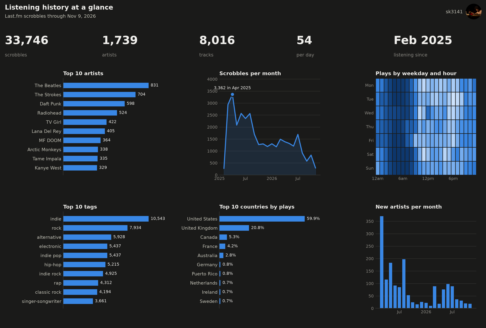
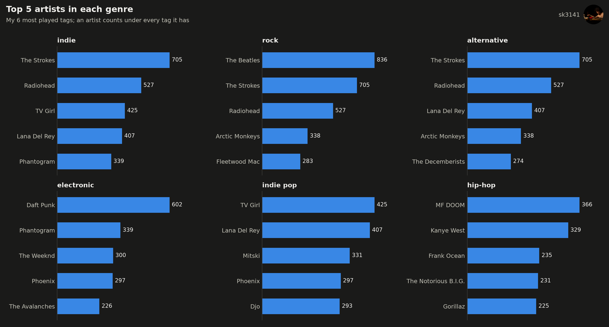
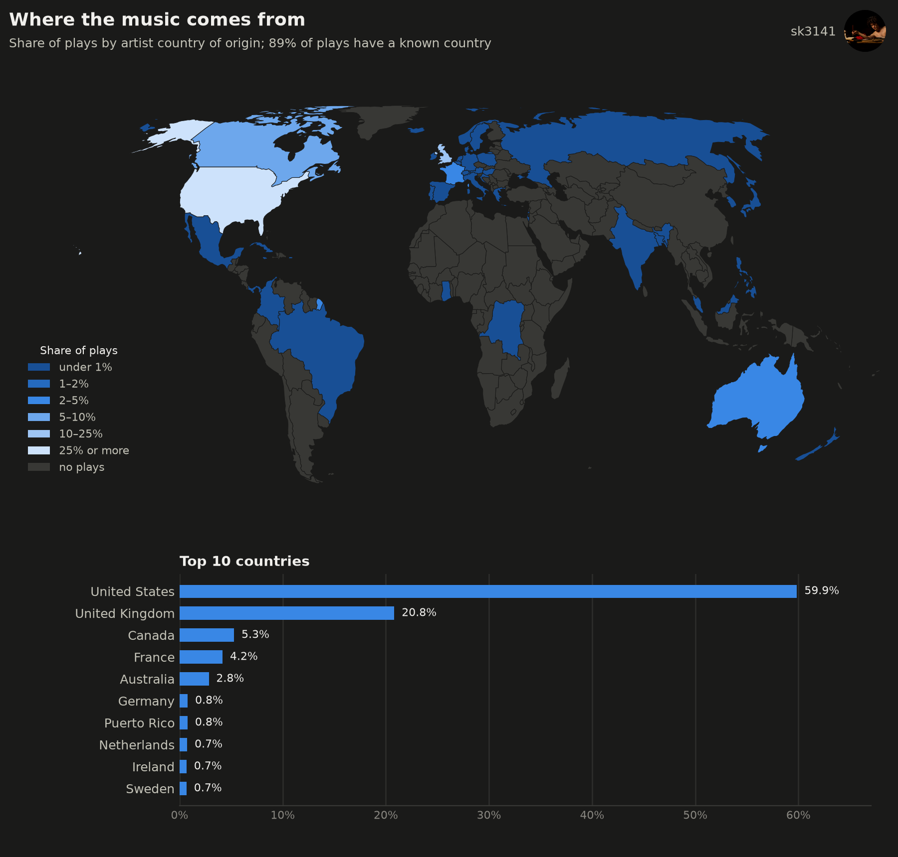
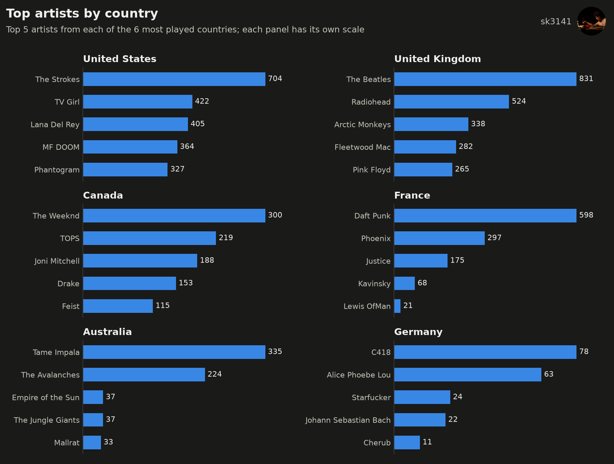
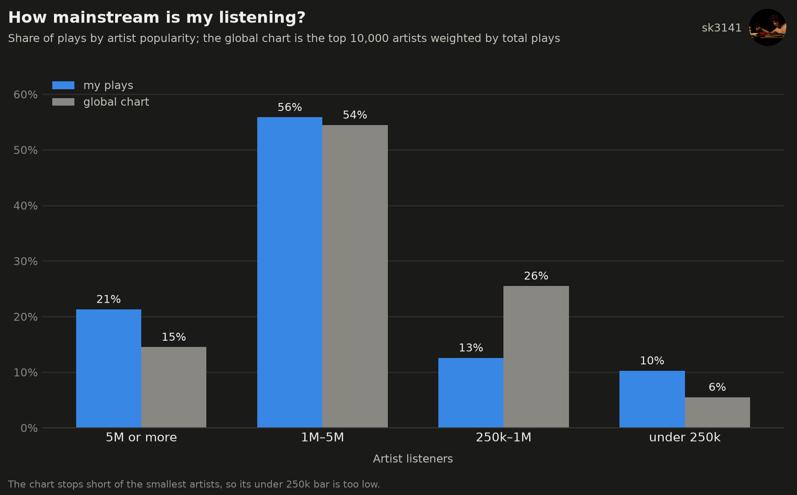
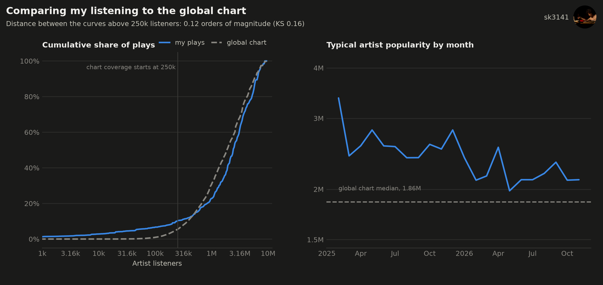
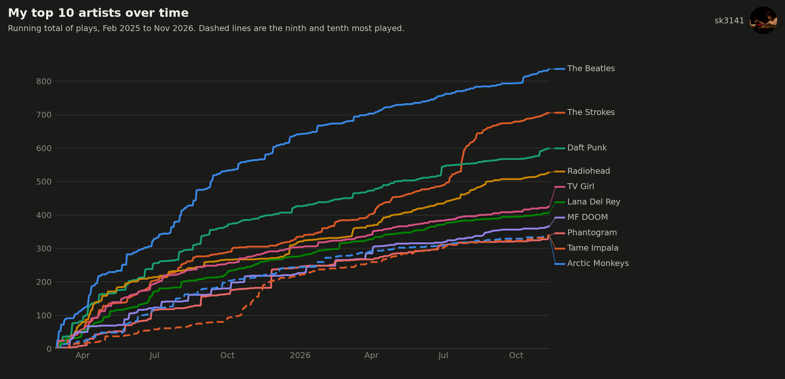
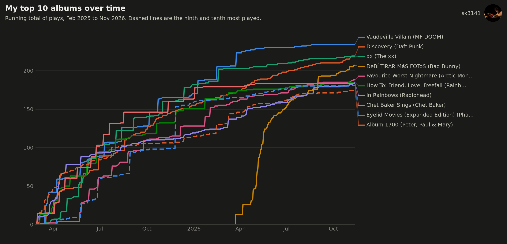
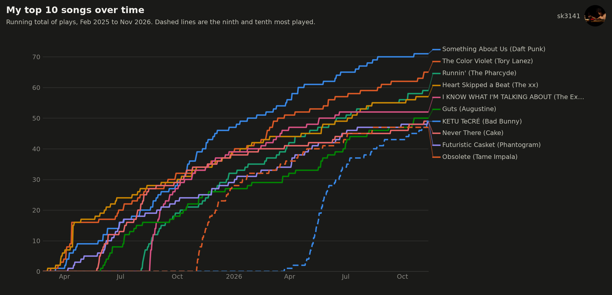

# Last.fm Listening History

Explore a Last.fm scrobble history with pandas and matplotlib: what gets played, when, and how listening breaks down by genre. The notebooks pull data from the Last.fm API, clean it, and chart it.






















## What I found

From my own scrobbles, so yours will differ, and they only cover songs from my library (see the notes below). My listening is close to the global baseline: 56% of my plays are artists with 1M to 5M listeners, against 54% for the chart, and my typical artist is a little more popular than the chart's median (about 2 to 3M listeners against 1.86M). Next to the chart I play more of the very biggest artists (21% above 5M listeners, against 15%) and fewer in the middle (13% between 250k and 1M, against 26%).

## What's in here

| File | What it does |
|---|---|
| `00_ingest.ipynb` | Pulls scrobbles from the Last.fm API (`user.getRecentTracks`), then fetches tags and global stats for every artist (`artist.getTopTags`, `artist.getInfo`), looks up each artist's country of origin on MusicBrainz, and pulls the global top artists chart. Raw artist responses are cached so the pull can resume, and everything is saved as Parquet. Also writes the sample data. |
| `01_top_charts.ipynb` | Top artists, albums, songs, and tags for a chosen period (week, month, 3 months, 6 months, year, or all time). |
| `02_time_patterns.ipynb` | Scrobbles per month, and a weekday-by-hour heatmap. |
| `03_genres.ipynb` | How the genre mix changes month to month, one panel per top tag. |
| `04_discovery.ipynb` | New artists per month, and the share of each month's plays that went to artists heard for the first time. |
| `05_countries.ipynb` | A world map shaded by share of plays by artist country of origin, with a ranked bar chart of the top countries, and the top artists from each of the top countries. |
| `06_summary.ipynb` | One summary figure: headline numbers, top artists, scrobbles per month, weekday-by-hour heatmap, top tags, top countries, and new artists per month. |
| `07_mainstream.ipynb` | How mainstream my listening is: my plays by artist popularity next to the global Last.fm chart, with the two distributions compared (Wasserstein distance and KS statistic) and my typical artist popularity by month. |
| `08_top_over_time.ipynb` | Running total of plays for my top 10 artists, albums, and songs, one line each, from the first scrobble to the latest. One chart for each. |
| `09_top_artists_per_genre.ipynb` | The most played artists in each of my top genres, and a function that looks up the top artists for any tag. |
| `tags.py` | Tag cleaning: the stoplist, aliases, weight cutoff, and tags-per-artist limit. |
| `viz.py` | Shared dark theme colors and chart helpers. |
| `profile.json`, `profile.png` | Username and profile picture shown in the corner of each chart. Written by `00_ingest.ipynb`. |
| `sample_data/` | A recent slice of scrobbles with the matching artist and tag rows. |
| `figures/` | Charts exported by the notebooks. |

## Running it

Create the environment and start Jupyter:

```
conda env create -f environment.yml
conda activate lastfm-viz
jupyter lab
```

**With the sample data.** Open `01_top_charts.ipynb` or `02_time_patterns.ipynb` and run all cells. When `scrobbles.parquet` isn't in the project folder, the notebooks read from `sample_data/` automatically. The sample is a contiguous slice of recent listening and not a random sample, so time-of-day patterns stay intact.

**With your own Last.fm history.**

1. Create an API account at https://www.last.fm/api/account/create.
2. Make a file named `lastfm.env` in the project folder (it is gitignored):
   ```
   LASTFM_API_KEY=your_api_key
   LASTFM_USER=your_username
   TIMEZONE=America/New_York
   ```
   `TIMEZONE` is optional and defaults to UTC. Set it to your own [IANA time zone name](https://en.wikipedia.org/wiki/List_of_tz_database_time_zones) so the hour-of-day and weekday charts use your local time.
3. Run `00_ingest.ipynb` from top to bottom. The scrobble pull takes a few minutes. The artist step makes two API calls per unique artist, and the country step makes one MusicBrainz request per artist at about a second each, so a large library takes a while. Both are cached and can be re-run after an interruption. Once `scrobbles.parquet` exists, re-running the notebook only requests scrobbles newer than the saved ones, and only looks up artists it hasn't seen; set `FULL_REFRESH = True` in the fetch cell to pull the whole history again. The global chart is pulled once and reused; set `REFRESH_CHART = True` to pull a fresh one.
4. Run the other notebooks. They use your data instead of the sample once `scrobbles.parquet` exists.

## Notes on the data

- **Scrobbles only cover my library.** The app I scrobble with only logs songs from my own library, so anything I listened to outside it was never scrobbled. A lot of my listening isn't in this data, and every count here is a lower bound on what I actually played. Charts about discovery and popularity are affected most, since music I only streamed never shows up.
- **Time zone.** Timestamps are converted to the `TIMEZONE` setting in `00_ingest.ipynb`. The charts that group by hour or weekday show local time.
- **Tags are user-generated and attached to artists.** Last.fm has no genre field, so genres come from artist tags. Each tag has a weight from 0 to 100.
- **Tag cleaning** (in `tags.py`): drop tags that aren't about the music (`seen live`, `favorites`), vocalist-type tags, nationalities, and decades; drop tags with weight below 20; merge spelling variants (`hip hop` into `hip-hop`); keep at most 10 tags per artist. The lists are easy to edit.
- **Tag totals overlap.** A play counts once for every tag its artist has, so tag totals add up to more than the number of scrobbles.
- **New artists are relative to the history.** An artist is new in the month of their first scrobble, so listening from before the history starts isn't counted. The first month is left out of the discovery chart, since every artist is new then. With the sample data, "new" is relative to the sample.
- **Merged artists.** Last.fm treats some artists' side projects as separate artists, which splits their plays. MF DOOM, Madvillain, Viktor Vaughn and King Geedorah are four entries, and that spread my MF DOOM listening across all of them. `ARTIST_ALIASES` in `00_ingest.ipynb` renames them to one name when the scrobbles are saved, so the charts count them together. Add your own pairs there; the notebook merges plays that were saved earlier too. Collaboration credits such as `Madvillain, Madlib & MF DOOM` are separate entries and are left alone. The merged name is always written `MF DOOM`.
- **Country of origin comes from MusicBrainz.** Last.fm has no country field, so each artist is looked up by MBID. Artists without an MBID or without a country on MusicBrainz are left out of the country shares, and the chart subtitle reports how much of the listening that covers. A few wrong matches are corrected by hand in `COUNTRY_OVERRIDES` in `00_ingest.ipynb`. Country outlines are Natural Earth data, downloaded on first run.
- **Profile picture and username.** `00_ingest.ipynb` saves both from `user.getInfo`, and `viz.py` draws them in the corner of every chart. Delete `profile.json` to leave them off.
- **Mainstreamness compares against the global chart.** Artist popularity is the global listener count from `artist.getInfo`, today's number and not the count when the track was played. The baseline is the top 10,000 artists on Last.fm weighted by total plays, so it stands for a typical Last.fm scrobble and not a typical listener, and it can't see the smallest artists. The distribution comparison only uses artists above 250k listeners, and the share of plays below that is reported separately. There is no p-value, since plays aren't independent.
- **Partial months.** The first and current months are partial, and the monthly charts show them as they are. The discovery chart leaves out the first month, since every artist is new then.

## Planned

Listening sessions and a TensorFlow model for predicting what plays next.
