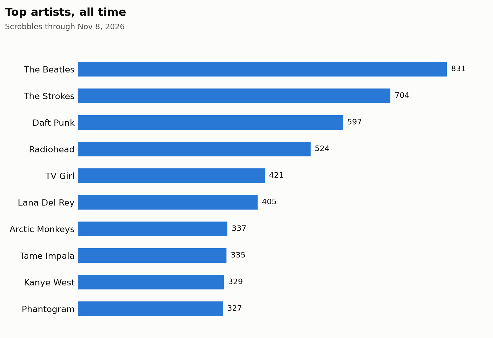
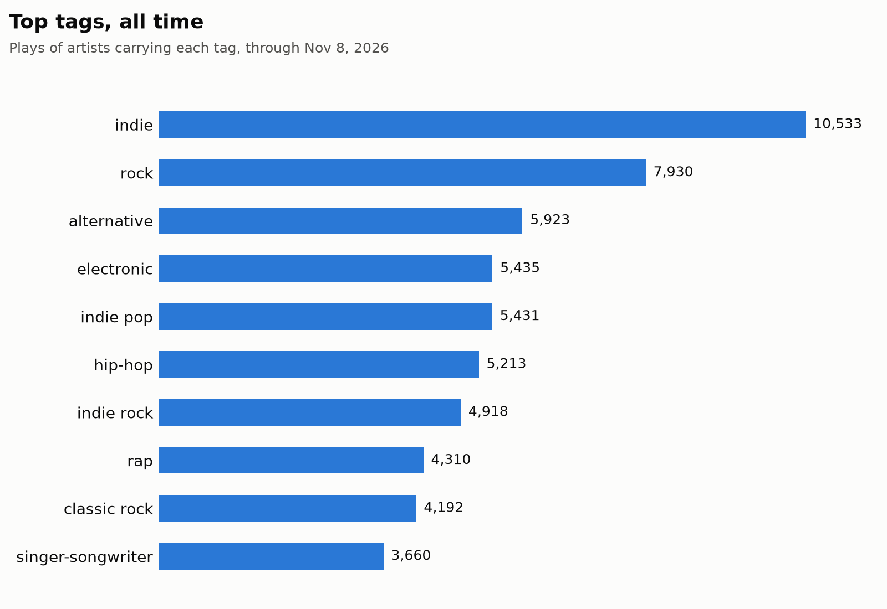
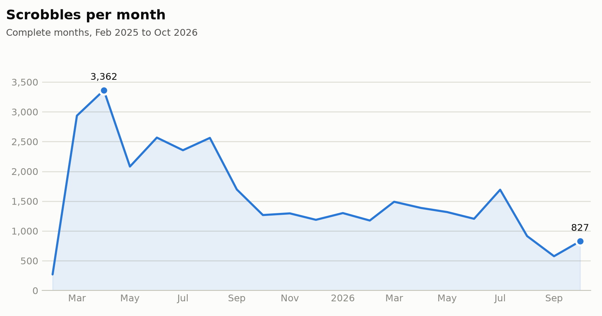
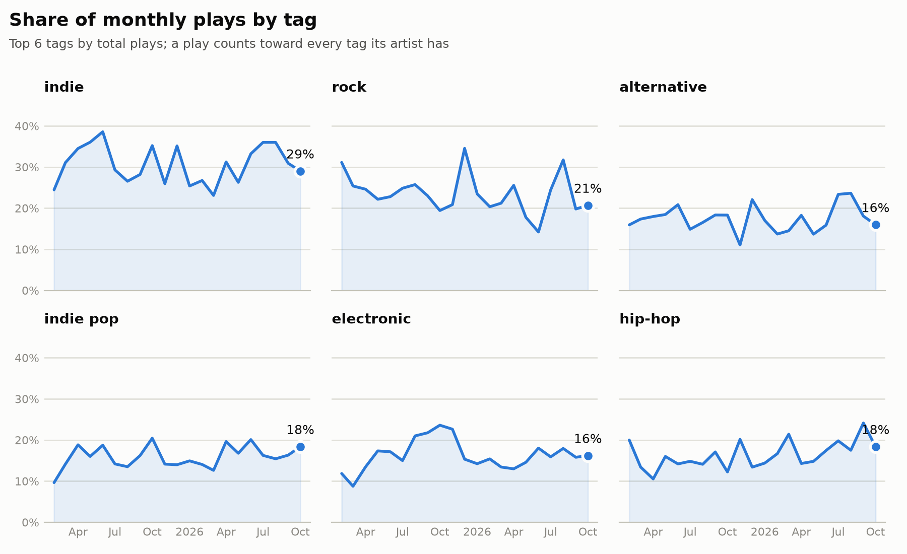
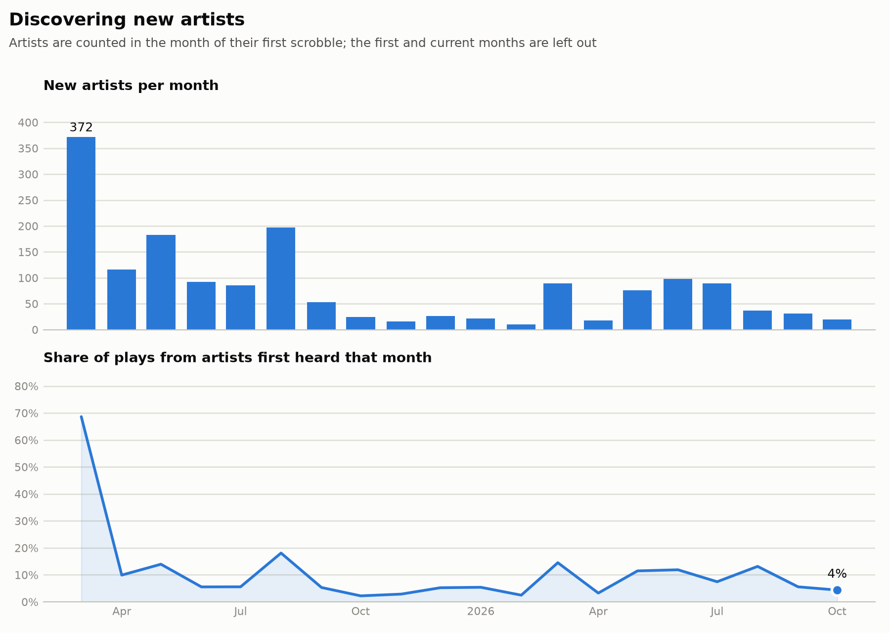
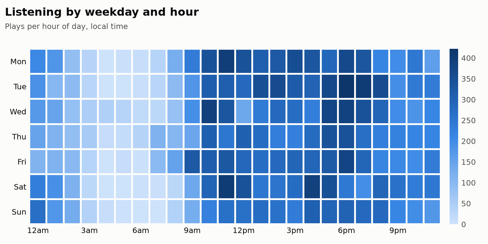

# Last.fm Listening History

Explore a Last.fm scrobble history with pandas and matplotlib: what gets played, when, and how listening breaks down by genre. The notebooks pull data from the Last.fm API, clean it, and chart it.













## What's in here

| File | What it does |
|---|---|
| `00_ingest.ipynb` | Pulls scrobbles from the Last.fm API (`user.getRecentTracks`), then fetches tags and global stats for every artist (`artist.getTopTags`, `artist.getInfo`). Raw artist responses are cached so the pull can resume, and everything is saved as Parquet. Also writes the sample data. |
| `01_top_charts.ipynb` | Top artists, albums, songs, and tags for a chosen period (week, month, 3 months, 6 months, year, or all time). |
| `02_time_patterns.ipynb` | Scrobbles per month, and a weekday-by-hour heatmap. |
| `03_genres.ipynb` | How the genre mix changes month to month, one panel per top tag. |
| `04_discovery.ipynb` | New artists per month, and the share of each month's plays that went to artists heard for the first time. |
| `tags.py` | Tag cleaning: the stoplist, aliases, weight cutoff, and tags-per-artist limit. |
| `viz.py` | Shared chart colors and helpers. |
| `sample_data/` | A recent slice of scrobbles with the matching artist and tag rows. |
| `figures/` | Charts exported by the notebooks. |

## Running it

Create the environment and start Jupyter:

```
conda env create -f environment.yml
conda activate lastfm-viz
jupyter lab
```

**With the sample data.** Open `01_top_charts.ipynb` or `02_time_patterns.ipynb` and run all cells. When `scrobbles.parquet` isn't in the project folder, the notebooks read from `sample_data/` automatically. The sample is a contiguous slice of recent listening and not a random sample, so time-of-day patterns stay intact.

**With your own Last.fm history.**

1. Create an API account at https://www.last.fm/api/account/create.
2. Make a file named `lastfm.env` in the project folder (it is gitignored):
   ```
   LASTFM_API_KEY=your_api_key
   LASTFM_USER=your_username
   TIMEZONE=America/New_York
   ```
   `TIMEZONE` is optional and defaults to UTC. Set it to your own [IANA time zone name](https://en.wikipedia.org/wiki/List_of_tz_database_time_zones) so the hour-of-day and weekday charts use your local time.
3. Run `00_ingest.ipynb` from top to bottom. The scrobble pull takes a few minutes. The artist step makes two API calls per unique artist, so a large library takes a while; it is cached and can be re-run after an interruption.
4. Run the other notebooks. They use your data instead of the sample once `scrobbles.parquet` exists.

## Notes on the data

- **Time zone.** Timestamps are converted to the `TIMEZONE` setting in `00_ingest.ipynb`. The charts that group by hour or weekday show local time.
- **Tags are user-generated and attached to artists.** Last.fm has no genre field, so genres come from artist tags. Each tag has a weight from 0 to 100.
- **Tag cleaning** (in `tags.py`): drop tags that aren't about the music (`seen live`, `favorites`), vocalist-type tags, nationalities, and decades; drop tags with weight below 20; merge spelling variants (`hip hop` into `hip-hop`); keep at most 10 tags per artist. The lists are easy to edit.
- **Tag totals overlap.** A play counts once for every tag its artist has, so tag totals add up to more than the number of scrobbles.
- **New artists are relative to the history.** An artist is new in the month of their first scrobble, so listening from before the history starts isn't counted. The first month is left out of the discovery chart, since every artist is new then. With the sample data, "new" is relative to the sample.
- **Partial months.** The monthly chart leaves out the current month, since it is still in progress.

## Planned

Listening sessions and a TensorFlow model for predicting what plays next.
